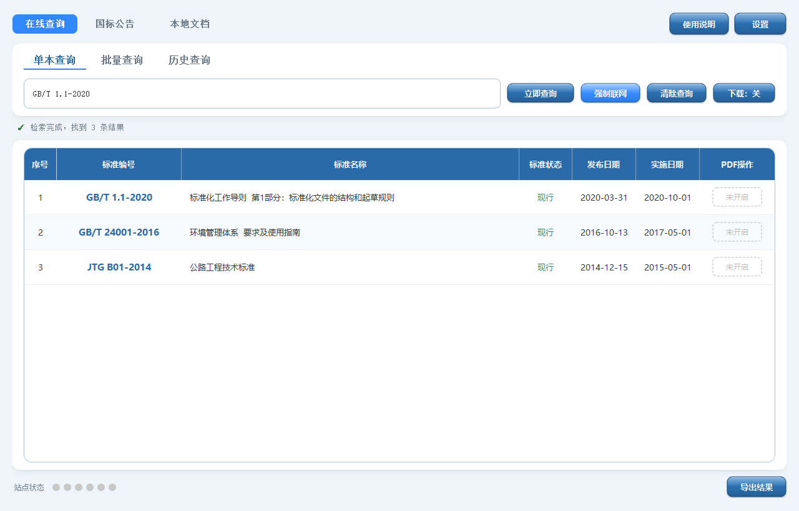
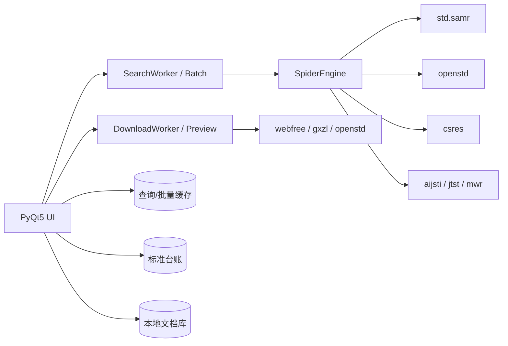

# 标准查新 / StandardQueryTool

当前版本：**v1.6.1**（Windows 10/11 / Python 3.13）

面向 Windows 10/11 的标准检索、状态查新与 PDF 获取桌面工具。聚合多个公开标准平台，支持单本查询、批量查新、替代关系提示、标准台账、本地文档库、PDF 预览与下载，以及自动更新。

> 本项目只用于检索公开标准题录与公开全文，请遵守各数据源的版权声明与使用条款；请勿用于批量抓取、商业转售或传播未获授权的标准文本。




## 功能

- **多源聚合检索**：全国标准信息公共服务平台、国家标准全文公开系统、工标网、爱查新、交通运输部、水利部等
- **状态与替代关系**：按实施日期校正“现行 / 即将实施 / 作废”，提示“已被替代 / 即将被替代”
- **单本 / 批量查询**：批量导入 `.xlsx` / `.txt`，批量结果独立缓存，支持导出 Excel
- **标准台账**：本地台账、替代提醒、导入 `.xlsx` / `.xls` / `.csv`
- **本地文档库**：扫描本地/局域网共享目录，按编号匹配已有 PDF，支持“本地打开”
- **下载与预览**：按下载源优先级轮动查找；协筑翻页 / 官方在线预览 / 临时 PDF 窗内翻页，确认后再保存
- **CLI**：`status` / `search` / `download`，JSON 输出，便于脚本或 AI 工具调用
- **自动更新**：Gitee 版本清单 + SHA-256 校验（清单提供哈希时）

## 数据源

| 来源 | 地址 | 用途 |
| --- | --- | --- |
| 全国标准信息公共服务平台 | <https://std.samr.gov.cn/> | 检索、详情 |
| 国家标准全文公开系统 | <https://openstd.samr.gov.cn/> | 检索、公开全文 |
| 工标网 | <http://www.csres.com/> | 检索、替代关系 |
| 爱查新 | <https://biaozhun.aijsti.com/> | 检索 |
| 交通运输部标准化信息系统 | <https://jtst.mot.gov.cn/> | 行业标准 |
| 水利部国际合作与科技司 | <http://gjkj.mwr.gov.cn/> | 行业标准 |
| 协筑资源 | <https://www.webfree.net/> | 下载（使用其公开共享口令） |
| 中国东盟标准云平台 | <https://bz.gxzl.org.cn/> | 下载（逐页图片合并 PDF） |

> “采标”标准（列表带“采”标识）通常不在官方平台提供全文，程序会跳过官方源并尝试其它公开渠道。

## 环境要求

- Windows 10 2004（build 19041）及以上 / Windows 11，64 位
- Python **3.13.x**（64 位；3.12 可运行，发布包建议 3.13）
- 可访问上述站点；部分站点需要较慢的超时容忍

## 快速开始（源码运行）

```bat
git clone https://github.com/lovethx2018/StandardQueryTool.git
cd StandardQueryTool

python -m venv .venv
.venv\Scripts\python.exe -m pip install -r requirements.txt
.venv\Scripts\python.exe main.py
```

首次运行会在程序目录创建 `config/`、`_temp/`、`_data/` 与默认下载目录 `电子规范/`。

## CLI

```bat
.venv\Scripts\python.exe cli.py status --json
.venv\Scripts\python.exe cli.py search "GB/T 1.1-2020" --json
.venv\Scripts\python.exe cli.py search "GB/T 1.1-2020" --no-download-check --json
.venv\Scripts\python.exe cli.py download "GB/T 1.1-2020" --out "D:\电子规范" --json
```

- 进度信息写 stderr；`--json` 时 stdout 只输出 JSON。
- 退出码：`0` 成功，`1` 失败，`2` 需要浏览器手动操作（`NEED_BROWSER`）。

## 数据与配置位置

| 场景 | 配置 | 持久数据 | 临时文件 |
| --- | --- | --- | --- |
| 便携版（程序目录可写） | `config\` | `_data\` | `_temp\`、`update\` |
| 安装版（Program Files 不可写） | `%APPDATA%\StandardQueryTool\config\` | `%APPDATA%\StandardQueryTool\` | `%TEMP%\StandardQueryTool_temp\` |

- `query_history_cache.json`：单本查询历史（30 天 TTL）
- `batch_query_cache.json`：批量查询独立缓存（30 天 / 500 条）
- `standard_ledger.json`：标准台账
- 旧版数据会从 `_temp\` 自动迁移到新位置。

## 打包

```bat
.venv\Scripts\python.exe -m PyInstaller --clean -y StandardQueryTool.spec
```

- 使用 PyInstaller 6.x，输出 `dist\StandardQueryTool_v1.6.1_win10_win11_py313\`
- 安装包使用 [StandardQueryTool_setup.iss](StandardQueryTool_setup.iss)（Inno Setup 6）
- 构建目录请使用 **纯 ASCII 路径**（PyInstaller 6 + PyQt5 在中文路径下会报 Qt 插件目录不存在；运行时已由 `app_env.py` 兜底）
- 详细步骤见 [打包必备清单.md](打包必备清单.md)

## 架构



## 目录结构

```text
main.py                 # GUI 入口（含 --pdf-page-renderer 子进程入口）
cli.py                  # Headless CLI
app_env.py              # 编码/Qt 插件路径/目录可写兜底/日志
config.py               # 站点、下载源、用户设置
http_client.py          # requests + stdlib 兜底、SSL 降级
spiders/                # 各数据源解析与下载器
ui/                     # 主窗口、预览、文档管理、台账、更新
ledger/                 # 台账数据层
query_history/          # 查询历史 / 批量缓存
tests/                  # unittest
scripts/smoke_sources.py# 全数据源联网烟测
docs/                   # 截图与设计文档
```

## 测试

```bat
.venv\Scripts\python.exe -m unittest discover -s tests -v
```

联网烟测（会访问真实站点）：

```bat
.venv\Scripts\python.exe scripts\smoke_sources.py
```

## 已知限制

- 各站点页面结构变化可能导致对应解析器失效，欢迎提交修复与测试夹具
- 采标、内部标准、部分行业标准没有公开全文，程序只能给出题录与替代关系
- 批量检索目前为串行；重复关键词会命中批量缓存
- 自动更新默认指向作者维护的 Gitee 发布仓；如果你 fork 并自行发布，请修改 `ui/updater.py`、`version.json`，或关闭自更新

## 贡献

见 [CONTRIBUTING.md](CONTRIBUTING.md)。安全问题请按 [SECURITY.md](SECURITY.md) 私密报告。

## 许可证与第三方组件

本项目以 **GNU AGPL-3.0** 发布，见 [LICENSE](LICENSE)。

- PyMuPDF 为 **AGPL-3.0 或 Artifex 商业许可**，本项目按 AGPL-3.0 使用
- PyQt5 为 **GPL-3.0 或 Riverbank 商业许可**
- 其他依赖的许可证与版本见 [THIRD_PARTY_NOTICES.md](THIRD_PARTY_NOTICES.md)

如果你需要闭源分发或使用非 AGPL 许可，需要：
1. 购买 PyMuPDF 商业许可，或改用宽松许可的 PDF 渲染库；并且
2. 购买 PyQt 商业许可，或迁移到宽松许可的 GUI 方案。

## 免责声明

本项目与上述数据源站点无隶属关系。标准文本的版权归各自发布机构所有；本项目只做公开信息的检索与下载流程编排，不存储、不转售、不批量再分发标准全文。使用本项目造成的任何版权、合规或数据风险由使用者自行承担。